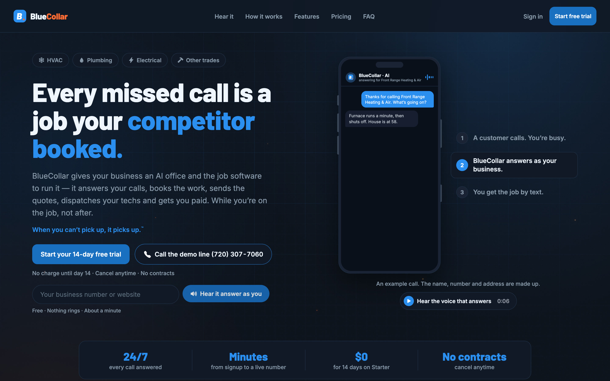
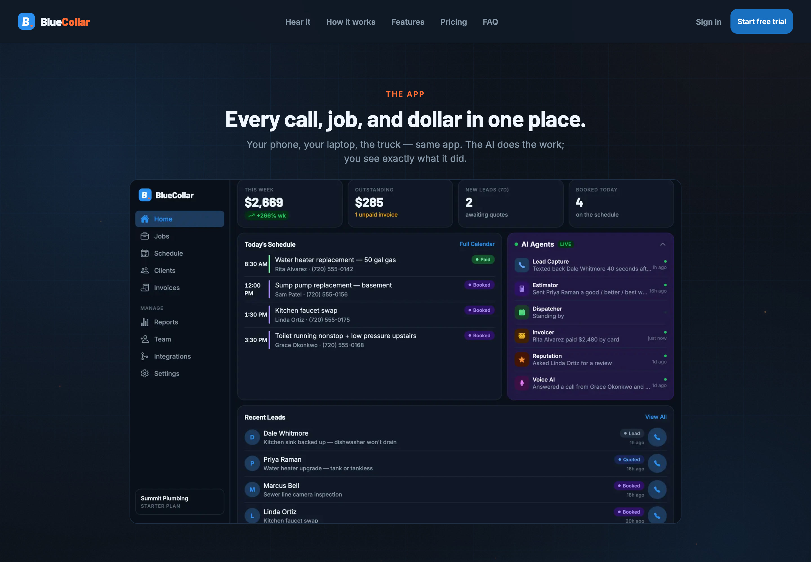
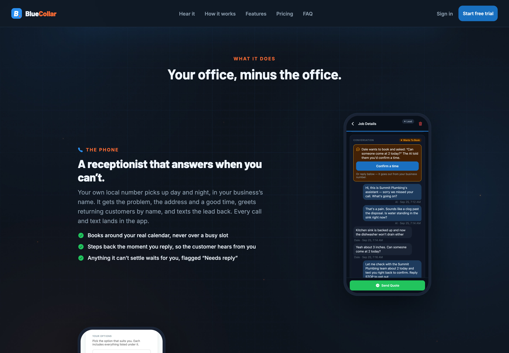
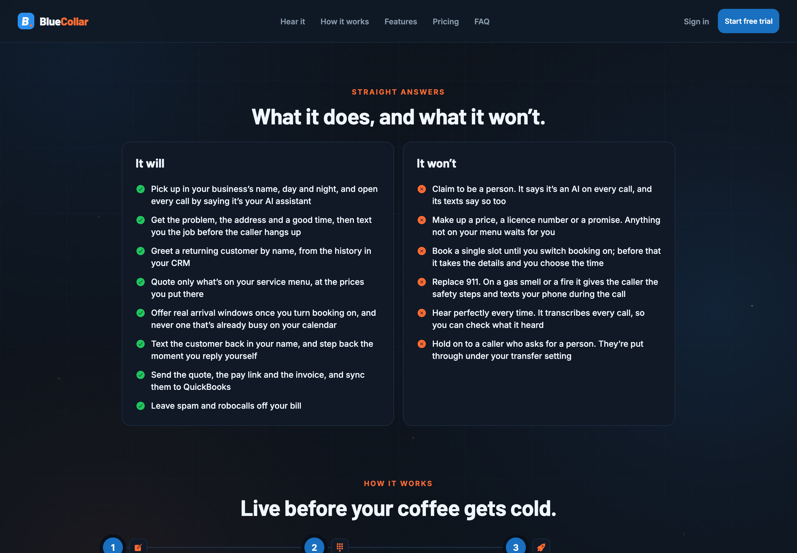

# BlueCollar

AI agent SaaS platform built for trades businesses — HVAC, plumbing, electrical — that replaces a front office with seven specialized AI agents operating in real time.

https://github.com/user-attachments/assets/22b85f61-4b3e-45fe-b9ff-f60194f3e3d8

▶ 22s launch video · [vertical 9:16 cut for mobile](media/bluecollar-launch-9x16.mp4) · [download landscape](media/bluecollar-launch-16x9.mp4)

**Live:** https://bluecollarapp.ai | **Admin Portal:** https://admin.bluecollarapp.ai

---

## What it does

Trades businesses lose jobs to slow response, missed calls, and unbilled work. BlueCollar deploys a fleet of agents to close every gap automatically — from the first missed call to the final invoice.

### 7 production agents

- **Voice Agent** — Deepgram STT → intent routing → ElevenLabs TTS. Answers calls, captures jobs, dispatches instantly
- **Lead Agent** — 4-layer growth engine: inbound capture (60s response SLA), customer reactivation, referral automation, outbound intel via permit feeds and weather triggers
- **Estimator** — AI quote generation with real pricing
- **Invoice Chaser** — cron-driven billing follow-up state machine
- **Dispatcher** — schedule optimizer with Google Maps integration
- **Reputation** — review management + Google My Business
- **Orchestrator** — DeepSeek R1 routing layer

---

## Stack

FastAPI (Python) · React Native · Next.js · Supabase (Postgres + Realtime) · LangGraph · CallNode telephony · ElevenLabs + Deepgram · Stripe · APScheduler · DeepSeek V3 + R1

---

## Infrastructure

Self-hosted on OVH LXC containers. App + API on CT 106. Admin portal with ops agent on CT 108 — god-mode credentials air-gapped from the app tier by design. All destructive ops park in a founder approval queue before execution.

---

## Pricing

Starter $189 · Growth $349 · Pro $599

---

## Screenshots

| | |
|---|---|
|  bluecollarapp.ai |  Every call, job and dollar in one place, with the agent feed |
|  The AI receptionist books, quotes and texts the lead back |  What it does, and what it won't: the guardrails, stated up front |
